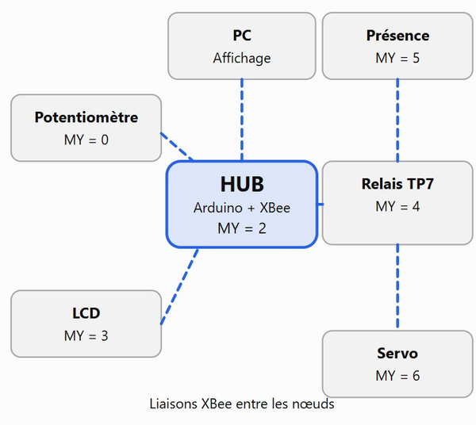
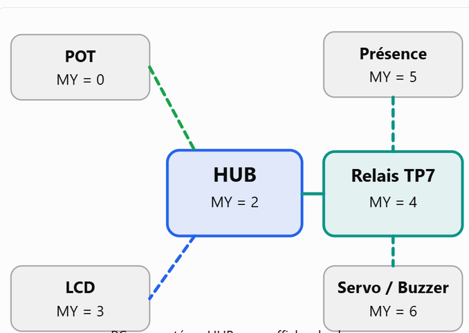
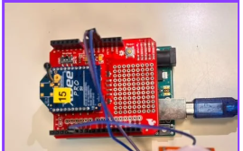
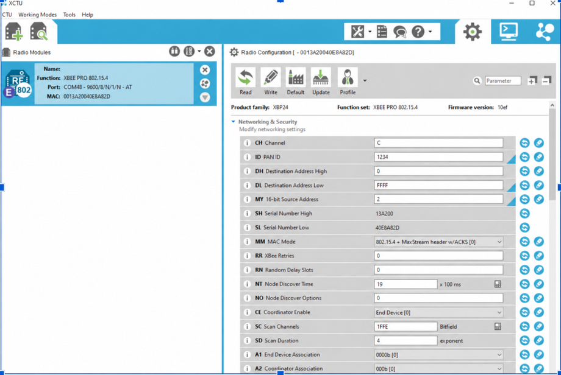
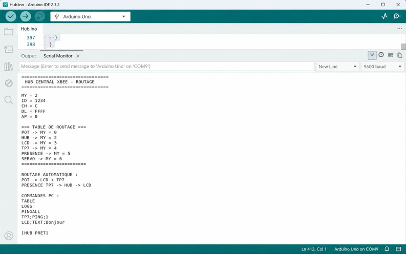
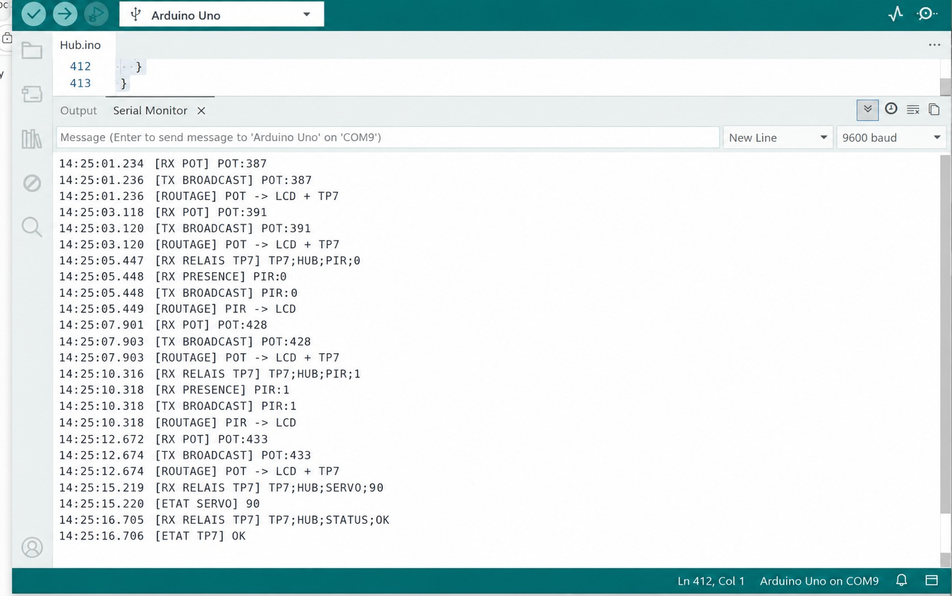

# XBee Wireless Sensor Network

<p align="center">
  <strong>Distributed sensor acquisition, wireless messaging and actuator supervision using Arduino Uno and XBee PRO 802.15.4</strong><br>
  Arduino · Embedded C++ · UART · IEEE 802.15.4 · XCTU · Integration Testing
</p>

<p align="center">
  
</p>

<p align="center"><strong>Academic team project — ENSIM, Le Mans University · 2026</strong></p>

## Overview

This project integrates multiple **Arduino Uno + XBee PRO 802.15.4** nodes into a wireless sensor-and-actuator network. A central **HUB (MY = 2)** receives potentiometer readings and presence information, validates messages, forwards relevant data to the LCD and coordinates with an intermediate relay **TP7 (MY = 4)**.

The system demonstrates embedded serial communication, an application-level messaging protocol, multi-node integration and serial diagnostics.

> **Terminology:** The hardware used here is XBee PRO 802.15.4 Series 1. The firmware uses XBee **transparent AT mode (AP=0)** and application-level message filtering, **not ZigBee mesh routing**. The HUB uses a broadcast destination (`DL=FFFF`), which does not provide per-node radio unicast.

## My contribution — central HUB

**Michael ESSOMBA** co-developed the HUB subsystem with **Arsene NGUENANG**. Its responsibilities include:

- receiving and validating analog readings (`POT:0` to `POT:1023`);
- processing presence states from the TP7 relay (`PIR:0` / `PIR:1`);
- limiting redundant potentiometer forwarding (threshold and 500 ms interval);
- handling relay feedback and serial diagnostic messages;
- maintaining the node address table and supporting PC console commands.

Other nodes were developed by separate student groups. Their source code must be added **only after contributor permission**, with accurate attribution.

## System architecture

<p align="center"></p>

| Node | MY | Role |
|---|---:|---|
| Potentiometer | `0` | Analog sensor readings |
| Central HUB | `2` | Message processing, forwarding and supervision |
| LCD | `3` | Display analog and presence values |
| Relay TP7 | `4` | Forwarding between presence sensor, HUB and actuators |
| PIR sensor | `5` | Presence detection |
| Servo / buzzer | `6` | Actuation and audible alert |

**Logical data paths:**

```text
Potentiometer (0) --POT:x--> HUB (2) --broadcast POT:x--> LCD (3) + TP7 (4)
PIR sensor (5) --0/1--> TP7 (4) --TP7;HUB;PIR;x--> HUB (2)
                                       |                |
                                       |                +-- PIR:x --> LCD (3) [broadcast]
                                       +-- TP7;SERVO;PIR;x --> Servo/Buzzer (6)
HUB --POT:x--> TP7 --TP7;SERVO;POT;x--> Servo (6)
```

The diagram describes intended application-level recipients. Because the HUB and TP7 use radio broadcasts in the documented build, other compatible modules may also receive the transmissions.

## Hardware and communication

- Arduino Uno, SparkFun XBee Shield and XBee PRO S1 (IEEE 802.15.4) for each communication node.
- **SoftwareSerial:** Arduino D2 (RX) / D3 (TX) connected through the XBee shield.
- **USB serial:** PC supervision through Arduino IDE at **9600 baud**.
- Network radio channel `CH=C`, PAN identifier `ID=1234` and transparent mode `AP=0`.

<p align="center"></p>

### XCTU configuration

| Parameter | HUB | TP7 relay | PIR |
|---|---|---|---|
| `MY` | `2` | `4` | `5` |
| `DH` | `0` | `0` | `0` |
| `DL` | `FFFF` | **See relay firmware version** | `4` |
| `ID` | `1234` | `1234` | `1234` |
| `CH` | `C` | `C` | `C` |
| `AP` | `0` | `0` | `0` |
| UART baud | `9600` | `9600` | `9600` |

> The submitted report describes a relay implementation that changes `DL` dynamically between destinations, whereas an earlier integration variant used broadcast `DL=FFFF`. Confirm which TP7 firmware/configuration was used before finalizing the table or claiming full reproduction.

<p align="center"></p>

## Message protocol

| Example message | Meaning |
|---|---|
| `POT:390` | Potentiometer reading |
| `TP7;HUB;PIR;1` | Relay forwards detected presence to HUB |
| `PIR:0` | Broadcast update: no presence |
| `TP7;SERVO;POT;390` | Relay forwards analog value to actuator group |
| `TP7;SERVO;PIR;1` | Relay forwards presence to buzzer group |
| `TP7;HUB;STATUS;OK` | Relay sends diagnostic status |
| `TP7;HUB;BUZZER;ON` | Buzzer state feedback, if implemented by actuators |

Line endings (`\n` / `\r\n`) delimit text messages. Applications parse and filter message fields; the radio itself does not enforce these logical destinations in broadcast mode.

## Firmware organization

```text
firmware/
  hub/                Central HUB firmware — contribution by Michael + Arsene
  potentiometer/      Awaiting source + publication approval
  pir-sensor/         Awaiting source + publication approval
  relay-tp7/         Awaiting source + publication approval
  lcd/                Awaiting source + publication approval
  servo-buzzer/       Awaiting source + publication approval
```

**Before uploading:** place the *actual verified Arduino IDE sketch* as `firmware/hub/hub.ino`. The supplied PDF includes the functional description and figures but not an authoritative full code listing. Avoid copying an untested intermediary version into the portfolio. See `firmware/hub/README.md`.

## Validation and serial supervision

The report describes node-level verification, serial RX/TX monitoring and integration tests using real hardware. Screenshots below are **report illustrations**; use actual capture logs for formal evidence whenever possible.

<p align="center"></p>

<p align="center"></p>

The detailed report is available locally to the project group. Its public redistribution requires permission from all relevant contributors.

### Reproducible checks

1. Verify Arduino Uno selection and XBee shield serial wiring (D2/D3).
2. Set XCTU `CH`, `ID`, `MY`, `DL`, `AP` and `BD` according to the implemented routing variant.
3. Upload the HUB firmware using Arduino IDE and open Serial Monitor at 9600 baud.
4. Check the initial configuration banner and `TABLE` command.
5. Introduce changing potentiometer readings and verify `POT:x` receptions and filtered forwarding.
6. Trigger PIR states 0 and 1 and inspect TP7-to-HUB frames and LCD responses.
7. Capture servo/buzzer feedback when implemented. Separate observed results from expectations.

## Limitations and next steps

- Broadcast messages can be received by unintended application nodes; source identification for bare `PIR:x` / `POT:x` is ambiguous.
- Dynamic `DL` switching in transparent mode introduces delays and complicates multi-destination messaging.
- The network is a classroom prototype, not a certified safety-critical or fault-tolerant system.
- Future: consistent structured frames, acknowledgments, packet-loss and range measurements, and XBee API mode for destination-aware transmission.

## Contributors and credits

This is a multi-group ENSIM academic project. **HUB subsystem: Michael ESSOMBA and Arsene NGUENANG**. The source report credits the teams responsible for LCD, potentiometer, PIR, relay and actuators. See [`docs/CONTRIBUTORS.md`](docs/CONTRIBUTORS.md); add each team's code only with permission.

**Status:** Documentation and repository scaffold prepared from the final report. Full software publication and reproducibility depend on collecting and verifying the final firmware files.
